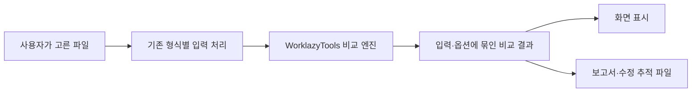

# 비교 기능 이식 구조와 작업 기록

사용자는 2026-10-23에 `diffchecker` 분석 결과를 이 레포의 GitHub Pages 정적 웹으로 이식하도록 승인했다. 기준은 기존 WorklazyTools의 비교 방식이며, 없는 기능이나 검증된 개선만 추가한다.

작업 브랜치는 `feat/diffchecker-browser-port-20261023`, 기준 커밋은 `92c21cabb930bce8cc306b95e2214bb6f1925379`다. 별도 작업 폴더에서 구현하며 기존 주 작업 폴더의 변경은 보존한다. 이 기록은 구현 진행 기록이다. 최종 통합 검사를 통과했다는 뜻이 아니다.

## 코드의 책임

| 위치 | 책임 | 유지하는 기준 |
| --- | --- | --- |
| `src/features/document-compare/` | 문단·표·글자·서식의 공통 비교 판단과 원본 위치 연결 | 기존 TypeScript 정렬·텍스트 비교를 기준으로 화면과 DOCX가 같은 판단을 사용 |
| `src/features/word-compare/` | DOCX 추출, 원본 참조 검증, 확정된 변경의 OOXML 출력 | Python에서 문단·표를 다시 맞추지 않음. 기존 변경 기록과 비교 제외 정책을 명시 |
| `src/features/excel-compare/` | 기존 위치·키·대사 엔진과 그 결과의 격자·XLSX 표시 | 수식·캐시·날짜 체계·중복 정책 유지. 화면과 파일이 같은 records를 소비 |
| `src/features/text-compare/` | 독립 양측 Text 비교, Ignore, 보기, 병합·되돌리기 | Word의 기본 diff를 교체하지 않음. 원문 범위·줄바꿈·인코딩 보존 |
| `src/features/image-compare/` | 픽셀 비교·변경 영역·정렬 후보·좌표·자원 관리 | 기존 PDF 픽셀 엔진은 유지. 작업 해상도와 원본 좌표를 구분 |
| `src/features/ocr-compare/` | 기존 로컬 인식 엔진을 사용한 비교·검토·정정 | 인식 원문·점수·박스와 사용자의 정정 글자를 분리 |
| `src/features/pdf-compare/` | 기존 페이지 비교에 보기와 대응 후보 추가 | 민감도 0/16/32의 기존 판정 유지. 후보는 확인 후 적용 |
| `src/features/folder-compare/` | 읽기 전용 목록·ZIP·바이트 검증·선택 쌍 상세 비교 | 원래 경로와 충돌 보존. 실제 파일 수정 없음. 기존 도구로 상세 비교 |
| `src/features/comparison-report/` | 확정된 결과의 출력 스냅샷과 파일 작성 | 비교를 다시 수행하지 않음. 구현·통합 검수는 별도 단계 |

## 판단과 출력의 흐름

Word의 공통 manifest에는 원본 노드, 문단·표 대응, 글자 범위, 서식 결정과 제외 정책이 들어간다. 출력기는 이 결과를 검증하고 조립한다. 지원하지 못하는 내용을 조용히 없애서 파일을 만들지 않는다.

서식·표·문서 정보를 비교에서 제외한 경우에는 그 부분을 수정본 기준으로 유지한다. 따라서 변경을 거절한 파일의 검증 기준도 선택한 비교 범위에 맞춘다. 대응하는 수정본 문단이 없는 완전 삭제 문단은 원래 서식을 복원한다. 기존 메모와 변경 기록의 보존 범위는 화면 안내와 출력 검사에 따로 기록한다.

Excel은 이미 하나의 `compareSpreadsheetPair` 결과를 화면과 보고서가 공유했다. 여기에 수동 열 대응과 원본 격자를 연결했다. 선택 열의 날짜 문자열 처리는 일반 문자열 값에만 적용하며 키·행 대응·대사·수식·계산 캐시를 바꾸지 않는다.

## 정적 배포 연결

새 도구는 `App.tsx`, `toolRegistry.ts`, `seo.ts`, `guideData.ts`, 한·영 locale 파일과 `generate-static-pages.mjs`를 함께 등록한다. 실제 `/ko/tools/.../index.html`, `/en/tools/.../index.html`과 사이트맵·FAQ를 생성하고 검증한다.

OpenCV 원본 입력은 `vendor/comparison/`에 고정한다. `scripts/vendor-comparison-assets.mjs`가 크기·해시를 확인하고 `public/vendor/`에 런타임과 전용 Worker를 만든다. 생성물을 직접 편집하지 않는다. Tesseract는 기존 고정 버전과 언어 모델을 재사용한다. 사용자 파일을 외부 인식 서비스에 보내지 않는다.

개발 서버의 격리 헤더에 의존하지 않도록 최종 `dist`는 일반 정적 서버에서도 확인한다. 루트 경로와 프로젝트 하위 경로를 모두 검사한다. 광고·분석은 기존 공개 문서 준비 상태 규칙을 따르며, 자동화 QA에서는 실제 공급자 요청을 차단한다.

## 공개 중단과 복구

`WORKLAZY_COMPARISON_PORT=off npm run build`로 비교 도구 여섯 개를 함께 비공개로 만든 정적 산출물을 만들 수 있다. 기본 빌드는 공개 상태다. 설정은 도구 목록, 직접 경로와 Word 결과 경로, 한·영 정적 페이지·사이트맵, 동적 noindex, 광고·분석 적격성에 같은 값으로 적용된다. 실제 값은 `dist/comparison-publication.json`에 기록한다.

이 스위치는 비교 도구 전체의 공개를 중단한다. Word의 화면과 출력기를 각각 옛 방식으로 바꾸지 않는다. 이전 버전으로 돌아가야 한다면 검증된 이전 정적 산출물 전체를 복구한다. 코드가 추가된 전용 브랜치와 기준 커밋도 보존한다. 빌드만으로 원격 사이트가 배포되지는 않는다.

## 검증과 진행 기록

상세 실행 기록은 이 작업 폴더의 `docs/jobs/todo/diffchecker-port-20261023/`에 둔다. 승인 원문은 `approved-plan.json`, 현재 단계는 `progress.json`, 적용 결정은 `contract-resolutions.json`이다. 상태 파일만으로 실제 프로세스나 감시가 실행 중이라고 판단하지 않는다.

작업은 기능별 고정 커밋으로 검수한다. 발견된 문제를 고친 뒤 같은 반례를 다시 확인하며, 기존 정답을 새 구현에 맞춰 약화하지 않는다. 현재까지 큰 반복 텍스트, 원문 줄바꿈, Word 대응·서식·개체 보존, 이미지 자원 한도, ZIP 종료·취소와 잘못된 경로 대응을 이 방식으로 검사했다.

최종 통합 후보에는 빌드·전체 단위 검사·정적 출력 검사와 변경 도구의 실제 브라우저 검사를 적용한다. 초기 체크포인트 통과를 전체 작업 완료로 표시하지 않는다. 남은 부분과 형식별 제한은 최종 작업 기록에서 구분한다.

작성: Codx
